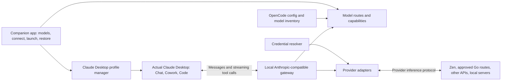

# High-level implementation plan: OpenCode → Claude Desktop

Prepared 17 September 2026. Evidence and source review: [RESEARCH.md](RESEARCH.md).

Implementation has started. See [BUILD_STATUS.md](BUILD_STATUS.md) for delivered code and validation. Live requests to two Zen free-tier routes returned `FreeTierError` restricting use to OpenCode; an installed local Ollama model passed a streamed SDK tool round trip. The actual Desktop Phase 0 gate below remains open.

## Product outcome

A macOS companion application lets a user select models from their OpenCode connections, connect Claude Desktop, and launch it. Chat, Cowork, and Code send inference requests through our gateway to those selected models. Users can inspect the actual provider/model and restore their previous Desktop connection.

Recommended delivery: **standalone companion and gateway first; shared OpenCode provider runtime later**. Ship a small tested compatibility list rather than claiming every model visible in OpenCode will work.

The design below is a proposal. Its live compatibility assumptions are validated in Phase 0. No integration commands shown here are existing features of OpenCode.

## Architecture

Claude Desktop remains responsible for task execution, permissions, conversation history, and its tools. The bridge performs inference routing and protocol conversion. Importing an OpenCode model connection does not transfer OpenCode sessions, agents, skills, or tool configuration.

Use a separate configurable loopback port, initially `127.0.0.1:41415`, after checking availability. Avoid Ollama’s desktop gateway port `11435` and OpenCode’s usual server port `4096`. Protect inference with a bridge-specific local credential; provider credentials remain upstream-facing.

## Main components

| Component | Responsibility | Important boundary |
| --- | --- | --- |
| Connection importer | Detect OpenCode version; resolve selected provider/model configuration | Import only explicitly selected connections |
| Credential resolver | API keys, environment references, later approved auth integrations | Do not treat OAuth tokens as generic API keys |
| Route registry | Claude-facing IDs, backend identity, tier mapping, capabilities | Route IDs must remain stable across refreshes |
| Messages gateway | Request validation, inference routing, errors, streaming | No execution of Claude client tools |
| Provider adapters | Anthropic passthrough; Chat Completions/Responses conversion | Preserve provider-specific options and semantics |
| Profile manager | Apply a dedicated Desktop profile; journal and restore changes | Preserve existing profiles and policy settings |
| Process supervisor | Gateway health, startup, shutdown, app launching | Do not leave Desktop pointing to an unavailable service |
| Companion UI | Model selection, health, actual backend, launch/restart, restore | Explain unsupported routes before activation |

## Initial scope

The MVP supports macOS, selected API-key providers, Anthropic Messages and OpenAI Chat Completions upstreams, streaming text, client tool calls/results, cancellation, model discovery, token counting, and reversible Desktop setup. Validate basic Chat and Code first, then a constrained Cowork task.

Start with one Zen route that currently advertises Anthropic compatibility—MiniMax is a candidate—and one Zen Chat Completions route. Choose current IDs from the live catalog during development rather than embedding a permanent model list. A custom API-key connection verifies that the product extends beyond hosted OpenCode models. Add a local model with adequate context and tool support before claiming local operation.

Defer broad OAuth/subscription-provider reuse, arbitrary plugins, automatic provider failover, full computer use, and built-in server-tool emulation. OpenAI Responses is the next adapter after Chat Completions. Go is enabled only for validated coding workflows with proper client/session behavior, not assumed suitable for unrestricted general research. [Go requirements](https://opencode.ai/docs/go/).

## Phase 0 — prove the Desktop contract

Estimated effort: 2–4 engineer-days. This phase precedes desktop UI development.

1. Record exact Desktop/OpenCode/Ollama versions and identify the current active connection without collecting secrets into diagnostics.
2. Start a minimal authenticated bridge on a separate port and configure Desktop using its official in-app third-party inference window.
3. Test a real backend ID with explicit model metadata. If rejected or mapped incorrectly, test version-specific Claude compatibility aliases following Ollama’s pattern.
4. Confirm a streamed Desktop reply through one Anthropic-compatible OpenCode route. Record requested route, resolved provider/model, and upstream request correlation.
5. Confirm a client-tool call, Desktop permission handling, returned tool result, and final reply. Use a disposable workspace task.
6. Repeat text and tool tests through one translated Chat Completions route.
7. Verify Chat, Code, and a small Cowork workflow separately. Check auxiliary model requests, effort/thinking fields, token counting, cache fields, and session headers actually emitted by Desktop.
8. Restore the prior connection, which may be Ollama rather than a standard Anthropic profile.

**Exit gate:** evidence of inference and a complete tool round trip in the actual Desktop app through both upstream protocol types, plus successful restoration. If this fails, identify the client/protocol limitation before investing in a launcher. A successful curl request or Claude Code CLI test alone does not pass this gate.

Anthropic’s in-app window supplies validation and local application; its gateway requires streaming and tool use on Messages. [Configuration workflow](https://claude.com/docs/third-party/claude-desktop/in-app-configuration), [gateway contract](https://claude.com/docs/third-party/claude-desktop/gateway).

## Phase 1 — establish connections and routes

Estimated effort: 4–6 engineer-days.

- Implement a versioned configuration importer for the installed OpenCode generation, including selected custom endpoints, headers, environment references, model options, and configured allow/deny lists.
- Prefer resolved metadata from a supported API where practical. Discovery via `opencode serve` can help; inference must go directly through a provider adapter. Keep the gateway independent of an OpenCode agent session.
- Store references to credentials when possible. An explicit import may move a selected API key into macOS Keychain; retain compatibility with existing OpenCode storage without rewriting its auth file.
- Construct a normalized route record: stable route ID, provider ID, upstream model ID, protocol, label, auth strategy, context/output limits, and tested capabilities.
- Distinguish configured, reachable, authorized, and tested states. A catalog listing alone does not establish access or tool compatibility.
- Refresh availability without replacing the user’s saved selection or changing an in-flight request’s backend.

**Exit gate:** list and resolve the same selected hosted/custom API-key models as OpenCode; accurately identify unsupported connection types; keep credentials out of UI payloads and routine logs.

OpenCode’s provider resolution includes custom loaders and endpoint behavior, so a file importer is intentionally narrower than complete provider-runtime parity. [Provider implementation](https://github.com/anomalyco/opencode/blob/5a8335857b0ebec44ef6aa1d52b339cf25c329ca/packages/opencode/src/provider/provider.ts).

## Phase 2 — implement the inference gateway

Estimated effort: 7–12 engineer-days. This is the core engineering work.

### Gateway surface

| Endpoint | Behavior |
| --- | --- |
| `GET /health` | Bridge identity/version, readiness; no secrets |
| `GET /v1/models` | Claude-compatible catalog for selected, usable routes |
| `POST /v1/messages` | Streaming/non-streaming inference and client tool preservation |
| `POST /v1/messages/count_tokens` | Route-aware counting with a documented approximation policy |

### Adapter requirements

| Concern | Required behavior |
| --- | --- |
| Message content | Preserve system instructions, ordering, text blocks, assistant calls, and user tool results |
| Tool definitions | Translate schemas and selection controls only where supported |
| Tool IDs | Preserve correspondence; if rewritten, maintain reversible mappings across turns |
| Streaming | Emit valid Anthropic message/content lifecycle events and partial argument deltas |
| Parallel tools | Maintain independent content indices and tool-call identities |
| Termination | Map stop reasons and cumulative usage correctly |
| Failures | Convert errors before streaming; emit valid stream errors after streaming begins |
| Cancellation | Abort the upstream when Desktop cancels/disconnects |
| Slow models | Send keep-alive pings while respecting bounded timeouts |
| Caching | Preserve Anthropic breakpoints or map to supported upstream caching; report actual usage |
| Limits | Validate the actual backend’s input/output capacity before dispatch |
| Reasoning | Preserve native opaque state where supported; do not fabricate signatures or cross-provider replay |
| Images/documents | Support only tested content types; clearly reject unsupported content |

Use Anthropic-compatible passthrough when possible. Use a bounded protocol translator for Chat Completions, then Responses. A provider SDK can normalize upstream events, but a separate Anthropic serializer and preservation of provider metadata remain necessary. [Streaming specification](https://platform.claude.com/docs/en/build-with-claude/streaming).

Server-side web search, tool search, and code execution require distinct support. Client tools stay in Desktop. If a server tool is unsupported, return a clear capability error or offer a separately configured Desktop tool/connector path; do not silently reinterpret it as a working server tool. [Tool semantics](https://platform.claude.com/docs/en/agents-and-tools/tool-use/overview).

**Exit gate:** repeatable multi-turn tool workflows through both MVP protocols, cancellation, correct error behavior, and accurate route identity. Add translated Responses support only after these checks pass.

## Phase 3 — automate profile setup and launch

Estimated effort: 4–7 engineer-days.

Create a dedicated “OpenCode Bridge” profile with its own identity, never reuse Ollama’s profile UUID. The minimum logical connection contains `inferenceProvider: gateway`, our loopback base URL, a bridge credential or credential helper, and an appropriate auth scheme. This describes profile values, not permission to place them indiscriminately in the MCP configuration file.

Prefer real route IDs with explicit labels/tier metadata if Phase 0 validates them. Otherwise maintain a versioned compatibility-slot map, with the actual provider/model visible. Set extended context only after verifying the backend and client accept it; output limits and context windows are distinct. Keep effort controls aligned with tested backend support. Supply actual provider pricing or leave estimates disabled. [Model configuration reference](https://claude.com/docs/third-party/claude-desktop/configuration).

Apply changes transactionally: lock and snapshot owned fields/files → write a recovery journal → verify bridge readiness → handle any requested graceful restart → apply the profile → reopen Claude → verify profile and routing. Test rollback at each interruption point. Restoration returns to the captured prior connection and preserves unrelated edits made later.

An already active Ollama connection is a detected integration conflict, not permission to overwrite Ollama’s profile. Explain that selecting Connect switches the current Desktop backend. Never broaden sandbox egress or auto-mode permissions as a hidden side effect. If managed policy prevents a local change, report it and offer configuration export.

**Exit gate:** connect, launch, switch, restore, and crash recovery work without losing prior profiles or unrelated settings. The bridge is usable after a login/reboot according to the selected background-service policy.

## Phase 4 — deliver an Ollama-like companion UX

Estimated effort: 4–6 engineer-days.

The primary screen contains connection status, selected provider/models, Connect, Open Claude, Restart when needed, and Restore Previous Connection. A model settings screen assigns tested backends to supported model options and shows the actual model, local/cloud location, context/output limits, and capability status.

Startup flow: detect apps → find selected OpenCode connections → choose compatible models → check provider access → explain a required Desktop restart if running → activate → launch. Offer the official Claude download page if the app is absent; automated installation is optional later.

Diagnostics show recent routing metadata, latency, token usage, errors, and service health. Prompt/tool content capture is off by default and enabled only for a disposable development test. The product should say exactly what model is being used even when Desktop’s compatibility tier says Sonnet or Opus.

Suggested delivery technology: a TypeScript gateway using supported provider SDKs, with a thin Tauri/React companion and native macOS process/profile integration. This is a recommendation, not an existing workspace constraint. First compare a small LiteLLM experiment against a TypeScript adapter spike; select one translation engine before building both. [LiteLLM Anthropic interface](https://docs.litellm.ai/docs/anthropic_unified).

**Exit gate:** a user can launch Desktop with a selected tested backend and restore their previous connection without editing JSON.

## Phase 5 — expand OpenCode integration and distribution

Estimated effort: 5–10 engineer-days for initial hardening; additional providers/platforms are separate work.

Extract or add an inference-only OpenCode service that shares resolved providers, auth refresh, model settings, and compatible transforms. Expose it behind a narrow interface; avoid importing the full session/agent runtime. Pin the supported version and run compatibility tests on upgrades. An upstream OpenCode change would reduce long-term duplication; a maintained fork increases release responsibilities.

Add OpenAI Responses, a tested local route, and approved Go workflows. Consider provider-specific OAuth only with actual refresh/runtime integration and documented third-party-client support. Add Windows after separately verifying profile paths, process lifecycle, secret storage, and Desktop behavior. Linux is outside this MVP.

Package/sign the companion, provide update and uninstall recovery, establish a supported-version matrix, and retain a restore command that works even if the UI is unavailable. An OpenCode plugin may provide launcher entry points later, but the gateway must have a predictable lifecycle independent of an active agent turn.

## Validation and release criteria

| Area | Evidence needed |
| --- | --- |
| Identity/discovery | Selected routes appear in Desktop and reach the intended actual models |
| Chat | Multi-turn streaming conversation and stop behavior |
| Code | Read/edit a disposable project, tool results, and expected permission prompts |
| Cowork | Scoped file task and generated artifact using the selected backend |
| Auxiliary calls | Tier aliases/background requests remain on selected supported routes |
| Protocol | Split JSON arguments, parallel calls, Unicode, tool errors, interrupted streams |
| Availability | Bad key, provider outage, rate limit, occupied port, daemon exit |
| Context | Long input, output cap, oversized input error, compaction behavior |
| Lifecycle | Existing Ollama profile, repeated connect, external edits, crash during apply, reboot, uninstall |
| Data handling | Provider keys stay upstream; logs are redacted; local routes do not contact a cloud inference backend |

Run offline contract fixtures first, followed by a small live provider suite and actual Desktop smoke tests for each supported release. Keep protocol compliance separate from task quality: a model can speak the right API and still perform poorly under Claude’s agent prompts.

Bind only to loopback, authenticate inference, restrict Host/Origin, bound requests/concurrency, and permit only configured upstream routes. Do not accept a caller-supplied arbitrary upstream URL. Preserve session headers; use a stable session identity only when established from a reliable client signal. If it cannot be established for Go, keep that route disabled until resolved.

Document local versus cloud inference and other network paths. A local model alone does not guarantee offline operation, and provider retention differs by route. [Desktop network behavior](https://claude.com/docs/third-party/claude-desktop/telemetry).

## Main risks and decisions

| Risk | Mitigation or decision gate |
| --- | --- |
| Desktop rejects custom IDs or changes schema | Phase 0 evidence; explicit metadata; versioned compatibility fallback |
| Aliases imply incorrect thinking/context/pricing | Show actual identity; validate capabilities; override/disable incorrect estimates |
| OpenCode provider behavior diverges from importer | Narrow API-key MVP; share an inference service later |
| Two agents execute tools | Keep OpenCode’s agent/session runtime out of inference requests |
| Authentication type cannot be reused | Mark unsupported; add provider-native integration separately |
| Go usage/session behavior is unsuitable | Coding-only validation; no universal subscription reuse promise |
| Restart/config writes lose changes | Journal, graceful shutdown, conflict detection, field-aware restoration |
| Long-context/slow local models fail | Real backend limits, keep-alives, model-specific qualification |

For one experienced engineer, budget approximately **6–9 weeks for a constrained macOS beta**, assuming Phase 0 succeeds and existing adapters can be reused. Two engineers may reduce elapsed time, but protocol/lifecycle dependencies remain. Provider-wide parity and Windows are separate estimates. These are planning ranges, not delivery commitments.

The first concrete development deliverable is a disposable gateway proving one native Anthropic route and one translated Chat Completions route in the installed Claude Desktop, with a tool round trip and restoration to the existing Ollama connection.
