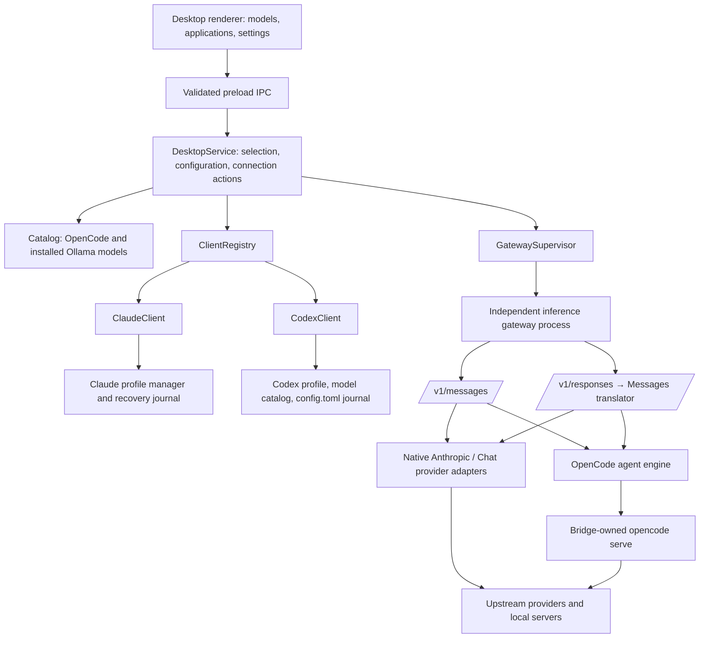

# Desktop integration architecture

OpenCode Bridge is a desktop companion with a reusable model/provider service and a registry of desktop client adapters. Claude (Anthropic Messages) and Codex (OpenAI Responses) are implemented and can be connected at the same time through one gateway.

## Boundaries

| Module | Owns | Adding a desktop client changes it? |
| --- | --- | --- |
| `renderer/` | Model search, selection, application cards, status, actions | Usually descriptor/icon presentation only |
| `src/desktop/contracts.ts` | Public DTOs; no credentials or unrestricted native API | Only for a new user-facing capability |
| `src/desktop/main.ts` and `requests.ts` | Trusted IPC, app window/tray, payload validation | Register the new implementation |
| `src/desktop/catalog.ts` | Model discovery, supported protocol and auth availability | No client-specific setup here |
| `src/desktop/service.ts` | Action serialization, saved choices, route configuration, gateway orchestration | Shared orchestration; extend capability checks as necessary |
| `src/clients/` | Client identity, installation/status, preview, launch, disconnect | Implement a new adapter |
| `src/profile.ts` | Claude-specific file schema, conflict detection, restoration | Keep separate; a different client gets its own configuration manager |
| `src/runtime.ts` | Gateway start/probe/stop and owned-process verification | Shared across clients |
| `src/gateway.ts` and `protocol.ts` | Anthropic-facing surface and provider wire translation | Add a client wire surface if a supported client uses another protocol |

Only enabled implementations may perform native actions. Planned descriptors cannot launch or mutate configuration. A registered implementation replaces its matching planned descriptor automatically.

## Adding an integration

1. Establish the target app's supported external inference contract. Opening an application alone is different from making its conversations use a chosen model. Do not implement model replacement through an unsupported assumption.
2. Implement `DesktopClient` under `src/clients/`: descriptor, installation/running/connection inspection, preview, recoverable launch, and disconnect. Keep bundle IDs and native commands inside the adapter, never accept shell commands or arbitrary application paths from the renderer.
3. Give the adapter its own recovery journal and configuration lock if it owns a different client store. Capture prior values before mutation; preserve unrelated edits; detect conflicts before restoring. The service keeps each client's routes separate (`routes` for Claude, `codexRoutes` for Codex) and only stops the gateway when no other client still uses it.
4. Declare the required client-facing inference protocol. Anthropic-compatible clients can reuse the existing surface. A client that officially accepts Chat Completions or Responses requires a new gateway surface; existing model discovery and upstream adapters still remain reusable. Disable it until the surface and actual client are tested.
5. Register the adapter in the main process. Descriptor metadata drives application cards. Persisted selections are already keyed by client ID.
6. Add orchestration/recovery tests and a real client inference/tool smoke test. Run the IPC tests and packaged-app checks so an unimplemented client cannot accidentally be enabled.

### Codex

Codex supports custom providers with `wire_api = "responses"`, as used by `ollama launch codex`. The adapter writes `<CODEX_HOME>/opencode-bridge.config.toml` (mode 0600, loopback bearer token) and `opencode-bridge-models.json`, a catalog with the backend's real effort levels, then opens `codex --profile opencode-bridge` in Terminal. For the Codex app, which reads root `config.toml`, it journals and moves only the top-level `model`, `model_provider`, `model_catalog_json` and `model_reasoning_effort` lines into a marked block. It appends a marked `[model_providers.opencode-bridge]` table and restarts the app. Disconnect removes both blocks and restores the original lines verbatim. Comments, tables and other keys are untouched.

### Local model sources and live updates

The catalog merges OpenCode's inventory, installed Ollama models (`/api/tags` + `/api/show`) and LM Studio's downloaded models. LM Studio comes from `/api/v1/models` when its server runs, otherwise from `lms ls --json`. Ollama and LM Studio models use their Anthropic-compatible Messages endpoints. Before launch, `ensureLmStudio` starts LM Studio's server (`lms server start`) and loads the selected models. `ModelWatcher` (`src/desktop/watch.ts`) polls cheap fingerprints every 4 s: Ollama tags, LM Studio keys or model folders, and the mtimes of OpenCode's `models.json`, `auth.json` and config. On a change, `DesktopService.refreshFor` rediscovers, reusing the cached OpenCode inventory for local-only changes. The main process pushes `desktop:changed` with added and removed models to the renderer.

### OpenCode agent routes

Models that cannot be reached directly use `protocol: "opencode"`: OpenCode Zen free models (restricted to OpenCode itself), OAuth logins, and SDKs without a bridge adapter. The gateway starts `opencode serve` lazily on loopback with a random `OPENCODE_SERVER_PASSWORD`, then stops it with the gateway. Sessions are created with an `ask` permission ruleset. The bridge answers each prompt from the configured policy, never interactive questions or doom loops. The app's own tool definitions are not forwarded; OpenCode's tools run instead, and each use is reported as a text note.

## Native boundary and process lifecycle

The renderer is a local packaged React UI with Node disabled, context isolation and sandbox enabled, restricted CSP, navigation/popups denied, and a custom secure application protocol. Its preload exposes one typed request method. The main process verifies the exact sender/main frame and validates action-specific payloads; provider keys and the bridge credential do not cross IPC.

Finder-launched apps receive a predictable search path for OpenCode's standard install locations. API keys still come from OpenCode's existing storage/configuration. Environment-only provider keys must be available to the launched app; selecting an absent credential source remains disabled.

The gateway is a detached helper started using Electron's bundled Node runtime, so users do not need a separate Node install for the packaged gateway. Closing the window hides it to the menu bar. Full Quit offers Disconnect & Quit, Keep Connected & Quit, and Cancel. Disconnect restores the captured original profile, gracefully restarts Claude, stops the owned gateway, and quits only after those steps succeed. Keep Connected explicitly leaves the gateway available. Active inference and restore conflicts prevent disconnection. Auto-restart, launch-at-login, and signed/notarized distribution are separate future lifecycle features.

The Applications panel maps Fable 5, Opus 5, Sonnet 5, Haiku 4.5, and Sonnet 4.6 independently. A route's `slot` distinguishes multiple models in one family, while `tier` identifies the family alias. Sonnet 5 is the Sonnet default; Sonnet 4.6 is an additional exact-ID route. Auto mode is stored as an explicit setting and defaults off. Apply & Restart resolves all selected routes and credentials before changing the profile, refuses active requests, and delegates a single restart to the client adapter's optional `apply` method. That method restores the previous profile before the service replaces the gateway configuration, then activates the new profile so its recovery journal continues to capture the original connection. Model discovery and fixture compatibility do not certify live inference or Auto mode on every provider.

Installed Ollama models discovered by the app use Ollama's native Anthropic Messages endpoint. This preserves thinking controls and stream events through its existing adapter. The generic Chat translator remains available for other compatible provider connections. Applied-profile status and completed-inference status are presented separately.

Implementation follows Electron's [security guidance](https://www.electronjs.org/docs/latest/tutorial/security) and [IPC guidance](https://www.electronjs.org/docs/latest/tutorial/ipc). Profile automation remains version-sensitive and requires actual Desktop validation beyond fixture tests.
