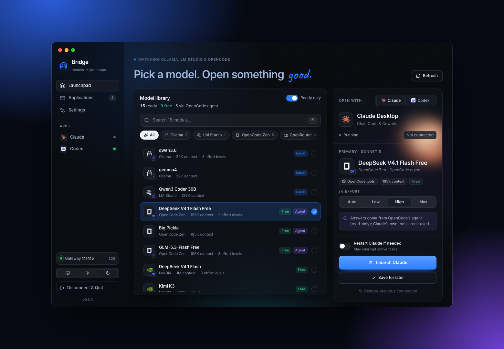
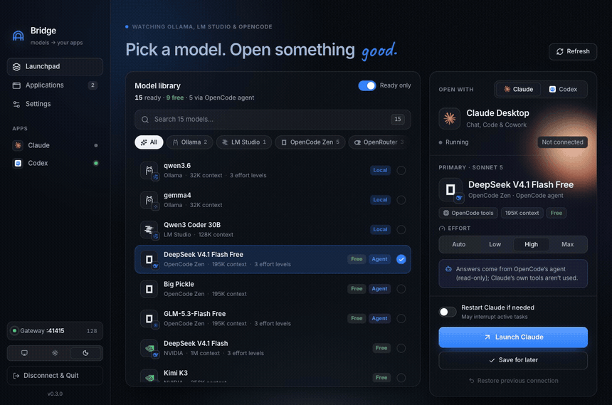
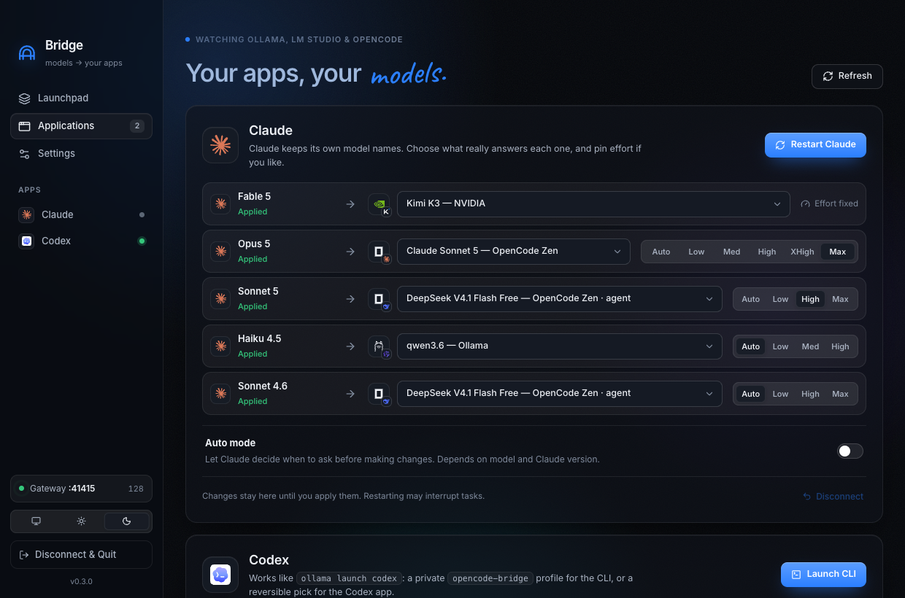
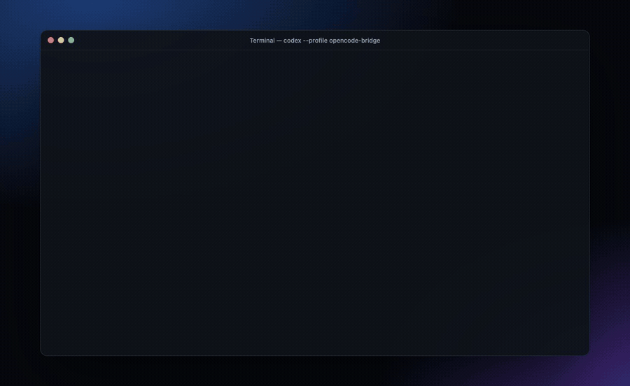
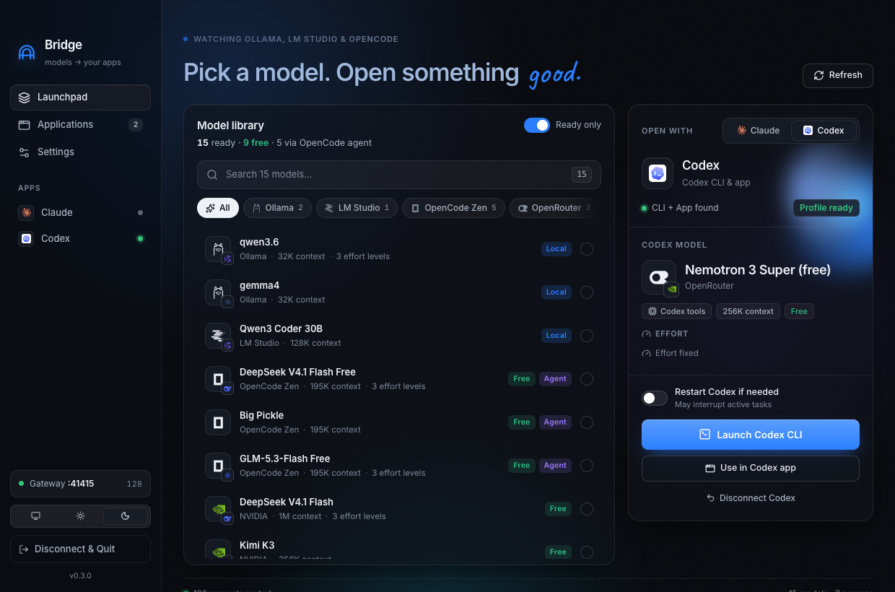
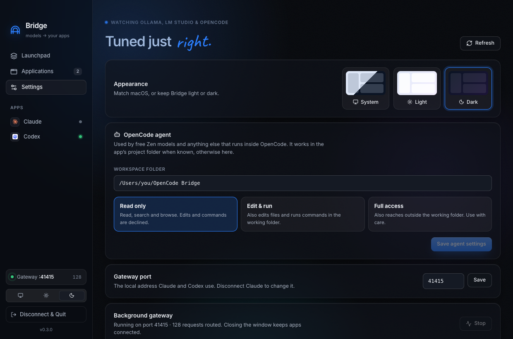
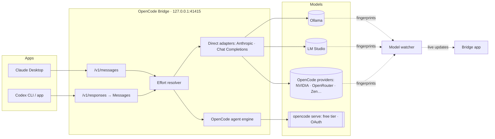

<div align="center">


# OpenCode Bridge

### Any model. Your favourite apps. Zero friction.

Run **free OpenCode Zen models**, **Ollama**, **LM Studio**, **OpenRouter**, **NVIDIA** and every OpenCode provider inside **Claude Desktop** and **Codex**. Claude keeps its own model names, while a model you choose answers behind the scenes, with the effort level you choose.

<p>
  <a href="#-quick-start"></a>
  <a href="#-testing"></a>
  
  <a href="LICENSE"></a>
</p>

<p>
  <a href="#-quick-start">Quick start</a> ·
  <a href="#-see-it-in-action">Demo</a> ·
  <a href="#-codex">Codex</a> ·
  <a href="#-free-opencode-models">Free models</a> ·
  <a href="#%EF%B8%8F-how-it-works">How it works</a> ·
  <a href="#-testing">Testing</a> ·
  <a href="#-faq--troubleshooting">FAQ</a>
</p>

<picture>
  <source media="(prefers-color-scheme: light)" srcset="docs/media/hero-light.png" />
  
</picture>

</div>

---

## ✨ Why Bridge?

Claude Desktop and Codex are great front-ends, but they only talk to their own clouds. **Bridge is the missing switchboard.** It works like `ollama launch` and is built for every model you already have:

| | |
| --- | --- |
| 🆓 **Free models, for real** | OpenCode Zen's free tier (Big Pickle, DeepSeek V4.1 Flash Free, GLM-5.3 Flash Free, Nemotron…) only works *inside OpenCode*. Bridge runs them in a private OpenCode agent, which is the supported way, with no API key and no tricks. |
| 🎭 **Claude names, your models** | Claude shows **Sonnet 5, Opus 5, Haiku 4.5, Fable 5 and Sonnet 4.6**. You decide what really answers each one. |
| 🧩 **Codex too** | One click opens `codex --profile opencode-bridge`, or switches the Codex app to your model. Undo is exact. |
| 🎚️ **Effort you control** | Pin Low → Max per model, or let the app decide. Requests snap to the levels a model actually supports. |
| 🔄 **Live model library** | `ollama pull`, an LM Studio download or a new OpenCode provider shows up within seconds, with no refresh. |
| 🛡️ **Safe by design** | Loopback-only gateway, journaled config edits, one-click restore. Your keys stay in OpenCode. |
| 🎨 **Premium app** | Glass light and dark themes, real provider logos, and smooth spring motion. |

---

## 🎬 See it in action

<div align="center">



<sub>Real app UI with demo data · <a href="docs/media/tour.mp4">▶︎ Watch in full quality (MP4)</a></sub>

</div>

### New models appear automatically


Bridge checks Ollama, LM Studio and OpenCode every few seconds using cheap fingerprints, not full scans. Against a real Ollama install, `ollama pull` showed up **~4 s** later and `ollama rm` **~2 s** later.

---

## 🚀 Quick start

**You need:** macOS (Apple Silicon), Node 22+, the [OpenCode CLI](https://opencode.ai) with at least one provider or the free tier, and optionally Claude Desktop, Codex, Ollama or LM Studio.

```bash
git clone https://github.com/satiricalguru/Opencode-bridge.git
```

```bash
cd Opencode-bridge && npm install
```

```bash
npm run app
```

Then:

1. **Pick a model** in the library. Free, local and agent models are all labelled.
2. Optionally **pin an effort** (Auto, Low … Max).
3. Hit **Launch Claude**, or switch to **Codex** and hit **Launch Codex CLI**.
4. Changed your mind? **Restore previous connection** puts everything back exactly.

> [!TIP]
> Press <kbd>⌘</kbd> <kbd>K</kbd> or <kbd>/</kbd> to search models. Use <kbd>↑</kbd> <kbd>↓</kbd> to move through the list.

<details>
<summary><b>Build a standalone .app or .dmg</b></summary>

```bash
npm run package:app
```

```bash
npm run package:dmg
```

Output goes to `release/`. Builds are unsigned, so right-click → **Open** the first time.

</details>

---

## 🤖 Claude Desktop

<picture>
  <source media="(prefers-color-scheme: light)" srcset="docs/media/applications-light.png" />
  
</picture>

Under **Applications → Claude**, map each Claude model name to any model and pin its effort. **Apply & restart** writes a dedicated Claude Desktop profile (`OpenCode Bridge`), restarts Claude, and keeps a recovery journal of your original settings.

| Claude shows | Answered by (example) | Effort |
| --- | --- | --- |
| Sonnet 5 | DeepSeek V4.1 Flash Free · *OpenCode agent* | High |
| Opus 5 | Claude Sonnet 5 · *OpenCode Zen* | Max |
| Haiku 4.5 | qwen3.6 · *Ollama, on your Mac* | Auto |
| Fable 5 | Kimi K3 · *NVIDIA* | Auto |

Direct routes (API-key providers, Ollama, LM Studio, OpenRouter) keep **Claude Code's own tools**: Bash, Edit and so on run client-side, exactly as in normal Claude.

---

## 🧩 Codex



<sub>A **real recorded session**: Codex CLI 0.153 → Bridge → OpenRouter's free Nemotron 3 Super. Codex executed `wc -l` and `cat` itself via translated tool calls. Long waits are shortened. Recorder: <a href="scripts/media/record-codex.ts">scripts/media/record-codex.ts</a> · <a href="docs/media/codex-cli.mp4">▶︎ MP4</a></sub>

<picture>
  <source media="(prefers-color-scheme: light)" srcset="docs/media/codex-light.png" />
  
</picture>

Bridge serves the **OpenAI Responses API** (`/v1/responses`), which is what Codex speaks, and translates it onto every model route. Like `ollama launch codex`, it offers two modes:

| Mode | What Bridge does | Undo |
| --- | --- | --- |
| **Codex CLI** | Writes `~/.codex/opencode-bridge.config.toml` (private, `0600`) plus a model catalog with real effort levels, then opens Terminal with `codex --profile opencode-bridge`. | **Disconnect Codex** deletes both files. |
| **Codex app** | Moves only the top-level `model`, `model_provider`, `model_catalog_json` and `model_reasoning_effort` lines into a marked block, adds a marked provider table, and restarts the app. | **Disconnect Codex** restores your original lines verbatim. Comments and every other setting are untouched. |

Claude and Codex can be connected **at the same time**. They share one gateway, and disconnecting one keeps the other working.

<details>
<summary><b>Use it by hand</b></summary>

After launching once from the app:

```bash
codex --profile opencode-bridge
```

```bash
codex --profile opencode-bridge exec "explain this repo in 3 bullets"
```

</details>

---

## 🆓 Free OpenCode models

OpenCode Zen's free models answer every non-OpenCode client with:

```text
FreeTierError: OpenCode's free tier can only be used from within OpenCode.
```

So Bridge **doesn't pretend to be OpenCode. It uses OpenCode.** For these models (and for OAuth logins like GitHub Copilot, or SDKs Bridge can't call directly), the gateway:

1. starts a private `opencode serve` on loopback, protected by a random password,
2. opens a real OpenCode session in your project folder (Claude Code's or Codex's working directory, or the configured workspace),
3. streams OpenCode's answer back as Claude or Codex events, with a short `⚙︎ tool` note for each tool OpenCode used,
4. answers OpenCode's permission prompts from **your policy**:

| Policy | OpenCode may… |
| --- | --- |
| **Read only** *(default)* | read, search and browse |
| **Edit & run** | also edit files and run commands in the working folder |
| **Full access** | also reach outside the working folder |

> [!NOTE]
> With these "agent" models, **OpenCode's tools** do the work, not Claude Code's or Codex's. Pick a direct model when you want the app's own tools. Models are badged **Agent** in the library.

<picture>
  <source media="(prefers-color-scheme: light)" srcset="docs/media/settings-light.png" />
  
</picture>

---

## 🧠 Local models: Ollama & LM Studio

| | Discovery | Route | Notes |
| --- | --- | --- | --- |
| **Ollama** | `/api/tags` + `/api/show` | Native Anthropic Messages (`:11434/v1`) | Tool, vision and thinking capabilities come from Ollama itself |
| **LM Studio** | REST `/api/v1/models`, or `lms ls` when the server is off | Native Anthropic Messages (`:1234/v1`) | Bridge starts LM Studio's server and loads the model on launch. Models not trained for tool use are shown but disabled. |

Nothing is ever downloaded or loaded just by browsing.

---

## 🎚️ Effort levels

Every model lists the effort levels it really supports (from OpenCode's model variants, or Ollama's thinking support). Pin one per Claude model name, or for Codex:

- **Auto** passes through what Claude or Codex asks for.
- **Pinned** always uses your level.
- If a request asks for a level the model lacks, Bridge picks the **nearest supported level** (rounding down on ties). It never silently drops the request or escalates it.

---

## 🏗️ How it works



| Piece | Where |
| --- | --- |
| Gateway, routing, effort | [`src/gateway.ts`](src/gateway.ts), [`src/effort.ts`](src/effort.ts) |
| Responses ⇄ Messages (Codex) | [`src/responses.ts`](src/responses.ts) |
| OpenCode agent engine | [`src/agent.ts`](src/agent.ts) |
| Chat Completions translation | [`src/protocol.ts`](src/protocol.ts) |
| Claude profile and recovery journal | [`src/profile.ts`](src/profile.ts), [`src/clients/claude.ts`](src/clients/claude.ts) |
| Codex profile and config journal | [`src/clients/codex.ts`](src/clients/codex.ts) |
| Discovery and live watcher | [`src/desktop/catalog.ts`](src/desktop/catalog.ts), [`src/desktop/watch.ts`](src/desktop/watch.ts) |
| App UI | [`renderer/src/main.tsx`](renderer/src/main.tsx), [`renderer/src/style.css`](renderer/src/style.css) |

More detail: [INTEGRATIONS.md](INTEGRATIONS.md).

---

## 🧪 Testing

```bash
npm test
```

```bash
npm run check && npm run check:ui
```

| Suite | What it proves | Result |
| --- | --- | --- |
| `npm test` (65 tests) | Anthropic and Chat translation, streaming, parallel tool calls, Responses ⇄ Messages, the agent engine against a fake OpenCode server, effort resolution, Claude and Codex config edits and exact restore, Claude+Codex orchestration, LM Studio discovery, watcher, IPC validation | ✅ 65 / 65 |
| `npm run smoke:launcher` | Real background gateway: start, reuse, inference, status, stop | ✅ |
| `npm run smoke -- <free model>` | Live client-tool round trip on a direct route (OpenRouter free) | ✅ |
| `npm run smoke:agent -- opencode/big-pickle` | Live free Zen model via the OpenCode agent: file read, streaming, follow-up | ✅ DeepSeek Free, Big Pickle |
| Anthropic SDK × 4 Claude names × 4 free models | Claude Code-shaped requests (tools, adaptive thinking, effort) | ✅ 10 s – 139 s |
| Real `codex exec` (agent and direct routes) | Codex's own shell tool via Responses | ✅ [recording](#-codex) |
| Real `ollama pull` / `ollama rm` | Live library updates | ✅ ~4 s / ~2 s |

Full logs, caveats and what was *not* exercised live are in [VERIFICATION.md](VERIFICATION.md) and [BUILD_STATUS.md](BUILD_STATUS.md).

<details>
<summary><b>Regenerate the README media</b></summary>

```bash
npm run media:codex
```

```bash
npm run media
```

`media:codex` records a real Codex session through a disposable gateway. `media` renders the real UI with demo data offscreen and encodes PNG, GIF and MP4 with ffmpeg.

</details>

---

## ⌨️ CLI

The app is the easy path. Everything also works headless:

| Command | What it does |
| --- | --- |
| `node dist/cli.js models [--provider ID]` | List models, protocol, agent eligibility, free flag |
| `node dist/cli.js init --model REF [--opus/--haiku/--fable/--sonnet46 REF] [--auto-mode] [--port N]` | Map Claude's model names. Free and OAuth models automatically use the OpenCode agent. |
| `node dist/cli.js start` / `stop [--restart]` / `status` | Background gateway |
| `node dist/cli.js profile` | Preview Claude profile changes (dry run) |
| `node dist/cli.js launch [--restart]` | Start gateway, apply profile, open Claude |
| `node dist/cli.js restore [--restart]` | Put Claude back exactly as it was |

---

## 🔒 Security

- **Loopback only.** The gateway binds `127.0.0.1`, checks `Host`, rejects browser `Origin`s, and requires a random 256-bit bearer token.
- **Keys stay in OpenCode.** Provider keys are read at request time and never written to Bridge files, Claude profiles or the UI.
- **Private agent server.** `opencode serve` runs on loopback with a random password and stops with the gateway.
- **Reversible edits.** Claude and Codex changes are journaled *before* any write. Restore detects external edits and refuses to overwrite them.
- **Locked-down UI.** Sandboxed renderer, strict CSP, a single validated IPC channel, and locally bundled fonts and icons.
- **Logs** hold only metadata: route, status, timing and token estimates. Never prompts, outputs or keys.

---

## ❓ FAQ & troubleshooting

<details>
<summary><b>A free Zen model fails</b></summary>

Check that OpenCode itself works: `opencode run -m opencode/big-pickle "hi"`. Bridge uses the same OpenCode, so if that fails, sign in or update OpenCode first.

</details>

<details>
<summary><b>Claude can't use its own tools with my model</b></summary>

That model runs through the OpenCode agent (**Agent** badge), so OpenCode's tools are used instead. Choose a direct model (API key, Ollama, LM Studio or OpenRouter) to keep Claude Code's tools.

</details>

<details>
<summary><b>An LM Studio model isn't selectable</b></summary>

LM Studio reports it isn't trained for tool use, or it isn't a chat model (embeddings and voice models). Download a tool-capable model and it appears automatically.

</details>

<details>
<summary><b>How do I undo everything?</b></summary>

Choose **Disconnect & Quit** from the sidebar or the app menu. Claude and Codex return to their exact previous settings and the gateway stops. Headless: `node dist/cli.js restore --restart`.

</details>

<details>
<summary><b>Port 41415 is busy</b></summary>

Change it under **Settings → Gateway port** (disconnect Claude first), or run `init --port 49152`.

</details>

---

## 🗺️ Roadmap

- [x] Free OpenCode Zen models via the OpenCode agent
- [x] Codex CLI and app support
- [x] Per-model effort levels
- [x] LM Studio, plus live model discovery
- [x] Light and dark premium UI
- [ ] Signed and notarized release builds
- [ ] Launch at login, with gateway auto-restart
- [ ] More apps as they open up to custom models

---

<div align="center">

**MIT licensed** · Brand marks from [LobeHub Icons](https://github.com/lobehub/lobe-icons) (MIT) remain trademarks of their owners.
Not affiliated with Anthropic, OpenAI, OpenCode, Ollama or LM Studio.

<sub>Built with Electron, React, TypeScript and a lot of streaming events.</sub>

</div>
