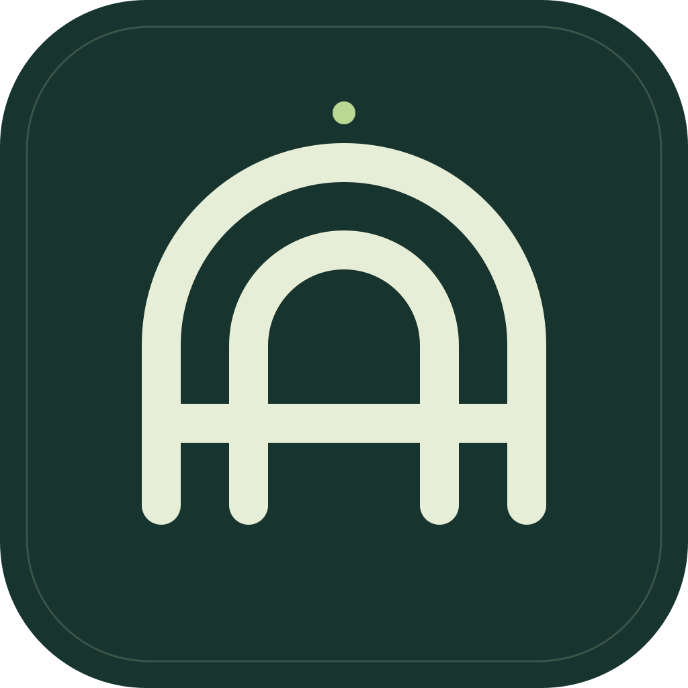
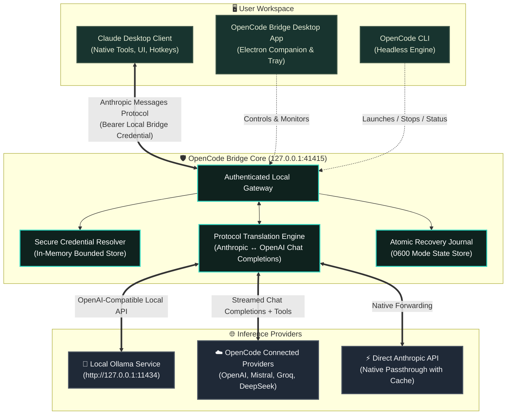
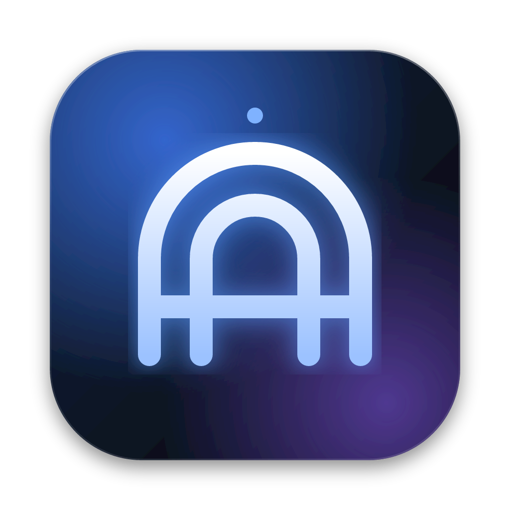

<div align="center">

  

  # OpenCode Bridge

  <p align="center">
    <strong>The seamless local gateway bridging OpenCode & Ollama models straight into Claude Desktop.</strong>
  </p>

  <p align="center">
    <a href="https://readme-typing-svg.demolab.com">
      
    </a>
  </p>

  <p align="center">
    <a href="LICENSE"></a>
    <a href="https://nodejs.org"></a>
    <a href="https://www.electronjs.org"></a>
    <a href="https://www.typescriptlang.org"></a>
    <a href="https://apple.com/macos"></a>
  </p>

  <p align="center">
    <a href="#-overview">Overview</a> •
    <a href="#-key-features">Key Features</a> •
    <a href="#-architecture">Architecture</a> •
    <a href="#-desktop-companion-app">Desktop App</a> •
    <a href="#-cli-quickstart">CLI Quickstart</a> •
    <a href="#-local-ollama-models">Ollama Setup</a> •
    <a href="#-security--state-isolation">Security & Recovery</a> •
    <a href="#-cli-reference">CLI Reference</a> •
    <a href="#-troubleshooting">Troubleshooting</a>
  </p>

</div>

---

## 🌟 Overview

**Verification status (18 September 2026):** Applications → Claude now provides independent Fable 5, Opus 5, Sonnet 5, Haiku 4.5, and Sonnet 4.6 selectors, an Apply & Restart button, and an Auto mode setting (off by default). The installed app applied the five-slot profile and Claude displayed all five entries, preserving the selected backend and effort. Full Quit now offers Disconnect & Quit, Keep Connected & Quit, or Cancel; closing the window hides Bridge in the menu bar. Actual local Desktop chat previously completed on retry, though cold latency remains a limitation. The main goal of OpenCode Zen free models remains blocked by HTTP 403, including Big Pickle through the genuine OpenCode CLI. See [VERIFICATION.md](VERIFICATION.md) for exact checks and limits. The local application build is unsigned and not notarized.

**OpenCode Bridge** empowers developers to unlock the full potential of **Claude Desktop** by routing inference requests through a resilient local gateway. Connect any model from your configured **OpenCode connections** or your locally running **Ollama** server, and interact using Claude Desktop's signature interface, keyboard shortcuts, and client tools.

Claude Desktop sends standard Anthropic Messages API requests directly to the bridge at `127.0.0.1`. The bridge intelligently determines how to fulfill each request:

- 🚀 **Native Anthropic Passthrough:** For upstream Anthropic providers, requests are forwarded transparently, preserving prompt caching, opaque thinking blocks, and specialized output headers.
- 🔄 **Real-Time OpenAI Translation:** For OpenAI-compatible providers and local Ollama instances, the bridge performs bidirectionally streamed protocol translation, transforming Anthropic messages into OpenAI Chat Completions and reconstructing tool calls with zero latency.
- 🛡️ **Fail-Safe Recovery Journaling:** Your original Claude Desktop profiles and configuration states are snapshotted in an atomic recovery journal before any modifications occur. Disconnecting instantly restores your previous settings.

---

## ✨ Key Features

| Feature | Description |
| :--- | :--- |
| **🖥️ Modern Desktop Companion** | Sleek Electron app with real-time model catalog browsing, status indicators, and menu bar tray controls. |
| **🧠 Local & Cloud Flexibility** | Effortlessly switch between local Ollama instances (e.g. Llama 3, Qwen 2.5, DeepSeek) and cloud API providers. |
| **⚡ Bidirectional Streaming** | Incremental token streaming with real-time tool calling and response handling. |
| **🎛️ Tier Overrides** | Map separate models to Sonnet, Opus, and Haiku tiers for optimal cost and performance. |
| **🔒 Air-Gapped Security** | Bound exclusively to `127.0.0.1`. Renderer has zero credential access; sensitive keys never leave the secure process boundary. |
| **💾 Atomic Recovery Journal** | Automatic backup and restore of Claude Desktop profiles. Restores pristine original state on disconnect. |
| **🛠️ Rich CLI Interface** | Complete terminal client for headless workflows, background daemons, and scripting. |

---

## 🏗️ Architecture

The following diagram illustrates how OpenCode Bridge orchestrates communication between Claude Desktop, local instances, and upstream providers:



---

## 🖥️ Desktop Companion App

The packaged Electron companion provides an intuitive, high-craft macOS experience:

<div align="center">
  
  <p><em>Built with Electron 44, React 19, TypeScript, and Vite</em></p>
</div>

### App Features:
1. **Search & Filter:** Instant search through all configured OpenCode models and detected local Ollama models.
2. **Ready to Connect Filter:** Highlights protocol-compatible models with available API-key credentials or discovered local endpoints. This does not certify inference access.
3. **Model Tier Overrides:** Independently map Opus and Haiku tiers to secondary models (e.g. route Haiku to a lightning-fast local model).
4. **One-Click Launch:** Automatically writes the bridge profile, starts the gateway daemon, and launches Claude Desktop.
5. **Instant Restoration:** Click **Restore previous connection** to cleanly remove bridge configuration, revert Claude Desktop settings, and shut down the gateway.
6. **Menu Bar Minimization:** Closing the window tucks the app into your macOS menu bar without disrupting active conversations.

### Running from Source:

```bash
# 1. Install dependencies
npm ci

# 2. Build the desktop app and renderer
npm run build:app

# 3. Launch the desktop companion
npm run app
```

### Packaging for macOS:

```bash
# Package into standalone arm64 .app bundle:
npm run package:app

# Generate macOS DMG installer:
npm run package:dmg
```

Output artifacts will be generated in the `release/` directory.

---

## ⚡ CLI Quickstart

If you prefer headless operation, SSH sessions, or terminal workflows, OpenCode Bridge includes a full-featured CLI:

### 1. Inspect Available Models
```bash
npm run build
node dist/cli.js models
```
The model list displays provider, protocol (`anthropic` or `chat`), context limits, and tool-calling support.

### 2. Initialize a Connection
```bash
# Initialize with your preferred provider and model
node dist/cli.js init --model PROVIDER/MODEL

# Example: Configure with the latest Claude 5 generation (Sonnet 5, Opus 5, Haiku 4.5)
node dist/cli.js init --model anthropic/claude-sonnet-5 \
  --opus anthropic/claude-opus-5 \
  --haiku anthropic/claude-haiku-4-5-20251001 \
  --port 41415

# Example: Route Haiku to a fast local model while using Claude Sonnet 5 for main tasks
node dist/cli.js init --model anthropic/claude-sonnet-5 \
  --haiku ollama-local/qwen2.5-coder:7b
```

> [!TIP]
> **Anthropic Claude Top-Tier Model Hierarchy:**
>
> | Model Tier | Identifier | Context | Best For |
> | :--- | :--- | :--- | :--- |
> | **Frontier** | `anthropic/claude-fable-5-1` | 1M | Maximum long-horizon reasoning & complex agentic workflows |
> | **Premium / Opus** | `anthropic/claude-opus-5` | 1M | Enterprise coding, multi-agent systems & deep architecture |
> | **Flagship / Sonnet** | `anthropic/claude-sonnet-5` *(or `claude-3-7-sonnet`)* | 1M | Recommended daily driver for coding, speed & intelligence |
> | **Fast / Haiku** | `anthropic/claude-haiku-4-5-20251001` *(or `claude-3-5-haiku`)* | 200K | High-throughput, sub-second latency tasks |

### 3. Verify Profile Preview
```bash
node dist/cli.js profile
```
*Previews target profile configurations without exposing credentials or modifying files.*

### 4. Start the Gateway & Launch Claude
```bash
# Start the background gateway daemon
node dist/cli.js start

# Check gateway health
node dist/cli.js status

# Launch Claude Desktop
node dist/cli.js launch
```
> [!TIP]
> If Claude Desktop is already open, pass `--restart` (`node dist/cli.js launch --restart`) to gracefully restart the app with the new bridge configuration.

### 5. Restore Pristine State
```bash
# Revert Claude Desktop to its previous state and stop the gateway
node dist/cli.js stop --restart
```

---

## 🦙 Local Ollama Models

Run state-of-the-art open models completely locally inside Claude Desktop:

### Step 1: Ensure Ollama is Running
Ensure your local Ollama server is running:
```bash
ollama serve
# Verify model availability
ollama list
```

### Step 2: OpenCode Configuration
The desktop app discovers installed Ollama models automatically. For CLI use, add a local model definition to your OpenCode configuration (e.g. `~/.config/opencode/opencode.json`):

```json
{
  "provider": {
    "ollama-local": {
      "npm": "@ai-sdk/anthropic",
      "name": "Ollama Local",
      "options": {
        "baseURL": "http://127.0.0.1:11434/v1"
      },
      "models": {
        "qwen2.5-coder:7b": {
          "name": "Qwen 2.5 Coder 7B",
          "tool_call": true,
          "limit": {
            "context": 32768,
            "output": 4096
          },
          "cost": {
            "input": 0,
            "output": 0
          }
        }
      }
    }
  }
}
```

### Step 3: Launch with the Local Model
```bash
node dist/cli.js init --model ollama-local/qwen2.5-coder:7b
node dist/cli.js launch --restart
```

Claude Desktop will now communicate with your local Ollama instance with zero internet egress!

---

## 🔒 Security & State Isolation

Security and failure recovery are core design principles of OpenCode Bridge:

```
+-------------------------------------------------------------------+
|                        SECURITY BOUNDARY                          |
+-------------------------------------------------------------------+
|  [ Claude Desktop ]                                               |
|        |                                                          |
|        | (Local Bearer Auth Token)                                |
|        v                                                          |
|  [ 127.0.0.1:41415 Gateway ]  <--- Rejects any external Origin    |
|        |                                                          |
|        | (Strict In-Memory Key Resolution)                        |
|        v                                                          |
|  [ Upstream Provider / Ollama ]                                   |
+-------------------------------------------------------------------+
```

- **Strict Loopback Binding:** The gateway binds solely to `127.0.0.1`. All incoming browser origin requests are blocked via CORS protection.
- **Credential Segregation:** Upstream API keys are resolved at runtime from local OpenCode stores and environment variables. Keys **never** enter the renderer process or disk-saved Desktop profiles.
- **Filesystem Permissions:** Bridge credentials and profile journals are stored in `~/Library/Application Support/OpenCode Claude Bridge` with strict `0600` POSIX file permissions.
- **Zero Data Retention:** Inference prompt bodies and upstream responses are streamed in-flight and never logged to persistent disks.
- **Fail-Safe Profile Journaling:** Before modifying any configuration files, the bridge records a journal snapshot. If an external conflict is detected during cleanup, restoration pauses safely rather than overwriting unexpected changes.

---

## ⌨️ CLI Reference

| Command | Arguments / Flags | Description |
| :--- | :--- | :--- |
| `models` | *none* | Lists all detected models with protocol, context, and capabilities |
| `init` | `--model <id>`<br>`--opus <id>`<br>`--haiku <id>`<br>`--port <num>` | Configures active routes and tier assignments |
| `profile` | *none* | Dry-run preview of profile changes to be applied to Claude |
| `start` | *none* | Spawns the background gateway daemon |
| `stop` | `[--restart]` | Stops the gateway and optionally restarts Claude |
| `status` | *none* | Checks whether the gateway is alive and displays active route details |
| `serve` | *none* | Runs the gateway service directly in the foreground |
| `launch` | `[--restart]` | Activates profile, ensures gateway is up, and launches Claude Desktop |
| `connect` | `[--apply]` | Activates configuration into Claude Desktop without launching the app |
| `restore` | `[--restart]` | Restores original pre-bridge Claude Desktop profiles |

---

## 🧪 Verification & Testing

OpenCode Bridge includes an extensive test suite simulating complex streaming and failover situations:

```bash
# Type check and syntax check
npm run check
npm run check:ui

# Execute unit and protocol test suite
npm test

# Run launcher background lifecycle smoke test
npm run smoke:launcher

# Run live zero-cost inference smoke test
npm run smoke -- PROVIDER/MODEL
```

### Protocol Tests Validate:
- Fragmented UTF-8 chunk reassembly
- Tool call definition and arguments streaming
- Anthropic Messages to OpenAI Chat Completions translation
- Prompt cache passthrough and token counting accuracy
- Atomic profile recovery under abnormal termination

---

## ❓ Troubleshooting

<details>
<summary><strong>1. HTTP 403 FreeTierError on OpenCode Zen Models</strong></summary>

The five currently supported Zen free endpoints tested returned HTTP 403 `FreeTierError`, restricting external use. Big Pickle also failed through the genuine latest OpenCode CLI v1.18.31; the bridge cannot resolve that provider response. This is not evidence that changing a user-agent header is a supported fix.
**Current alternatives:** An accessible provider API-key route or an installed local model. These alternatives do not fulfill the Zen free-model goal; see [verification results](VERIFICATION.md) and [OpenCode's matching issue](https://github.com/anomalyco/opencode/issues/49431).
</details>

<details>
<summary><strong>2. Claude Desktop fails to connect after gateway restart</strong></summary>

If the background gateway crashed or was killed unexpectedly:
```bash
# Restore previous connection
node dist/cli.js restore --restart
# Or restart bridge gateway
node dist/cli.js start
```
</details>

<details>
<summary><strong>3. Port 41415 is already in use</strong></summary>

Specify a custom port during initialization:
```bash
node dist/cli.js init --model PROVIDER/MODEL --port 49152
```
</details>

---

## 📄 License

This project is licensed under the **MIT License**. See the [LICENSE](LICENSE) file for details.

<div align="center">
  <sub>Engineered with precision for developers who demand full control over their desktop AI stack.</sub>
</div>
